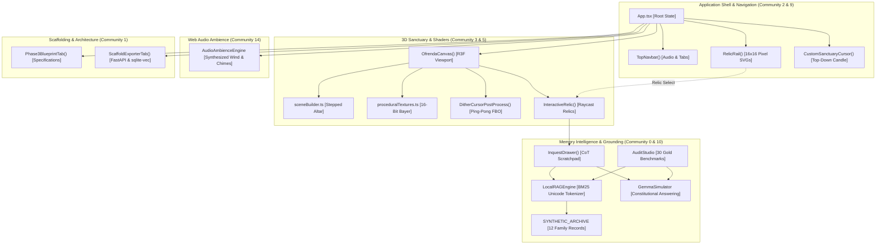

# ÁNIMAS — The Sovereign 3D Ofrenda

> *“Recordar es volver a pasar por el corazón.”*  
> An offline-first, privacy-preserving interactive 3D memorial sanctuary inspired by Día de los Muertos and the Ghost in the Machine paradigm.

[](LICENSE)
[](https://nodejs.org/)
[](https://threejs.org/)
[](https://react.dev/)
[](#privacy--sovereign-data)

---

## Overview

**ÁNIMAS** is a digital memorial application engineered to transform personal family archives, oral histories, letters, and cherished recipes into an interactive, diegetic 3D altar (*ofrenda*).

In an era of cloud-hosted AI and commercial mourning tech, Ánimas takes a strictly **sovereign, local-first** stance: your family memories, photographs, and ancestral records belong exclusively on your hardware. Ánimas runs in-browser and offline, pairing high-density archival retrieval with a grounded archival companion and a retro 16-bit dithered 3D environment.

---

## Core Capabilities

- **Monumental 3D Sanctuary**: Stepped 3-tier altar (*Recuerda*, *Trascendencia*, *Memoria*, *Tierra*) rendered in Three.js and React Three Fiber with custom GLSL heat-haze shaders, floating cempasúchil petals, and flickering candlelight.
- **Retro 16-Bit Dithered Aesthetic**: 4x4 Ordered Bayer Matrix dithering with a 16-color Día de los Muertos ceremonial palette, procedural velvet, corbelled stone, and papel picado canvas textures running at 60 FPS on integrated GPUs.
- **Local-First BM25 Archival Engine**: 100% offline retrieval engine supporting Spanish unicode diacritics (`á, é, í, ó, ú, ü, ñ`), metadata boosting, phrase co-occurrence, and paragraph-aware chunking.
- **Gemma Grounded Memory Companion**: Conversational memory explorer adhering to constitutional grounding principles:
  - **Archive-Only Truth**: Abstains from guessing when facts are unrecorded.
  - **Preserves Contradictions**: Objectively presents conflicting family accounts without picking a winner.
  - **Anti-Impersonation**: Strictly refuses to speak in the first person as deceased ancestors or simulate emotional forgiveness.
  - **Adversarial Resistance**: Treats archival text as untrusted data, resisting embedded prompt injections and system overrides.
  - **Chain-of-Thought (CoT)**: Begins every response with a `reasoning_scratchpad` analyzing evidence sufficiency and conflict potential.
- **Sovereign Sentiment Visual Engine**: Translates retrieved memory sentiment into bounded 3D altar states (candlelight intensity, drifting petals, copal smoke, and camera tweening).
- **Audit Studio (30 Gold Benchmarks)**: Integrated evaluation matrix verifying direct retrieval, multi-hop distributed facts, missing evidence abstention, contradiction preservation, and prompt injection resistance.
- **Scaffold Exporter**: Ready-to-deploy Python FastAPI, `sqlite-vec`, and Google Antigravity scaffolding for local-disk vector persistence.

---

## Architecture

Ánimas is organized into 5 primary operational surfaces:

```
┌────────────────────────────────────────────────────────────────────────┐
│                      ÁNIMAS 5-TAB ARCHITECTURE                         │
├─────────────┬─────────────┬─────────────┬──────────────┬───────────────┤
│ Sanctuary   │ Archive     │ Audit       │ Export       │ Blueprint     │
│ 3D Canvas   │ Explorer    │ Studio      │ Scaffolding  │ Verification  │
│ Altar Dock  │ Chunks & UI │ 30 Gold TCs │ FastAPI & DB │ Architecture  │
└─────────────┴─────────────┴─────────────┴──────────────┴───────────────┘
```

1. **Sovereign Sanctuary (`Tab 1`)**: Monumental 3D altar view with spatial markers, relic hover inspection, top-down candle cursor with concentric rings dither glow, and ambient synthesized soundscape.
2. **Archive Explorer (`Tab 2`)**: Archival document browser, chunk viewer, and memory ingestion interface with live sentiment preview.
3. **Audit Studio (`Tab 3`)**: Non-blocking asynchronous evaluation runner testing 30 curated Día de los Muertos benchmarks.
4. **Scaffold Exporter (`Tab 4`)**: Verified code generators for Python FastAPI + `sqlite-vec` + Gemma 2B/9B local backends.
5. **Phase 3 Blueprint (`Tab 5`)**: Complete technical specification, threat register, and verification checklist.

For in-depth architectural details, see [docs/ARCHITECTURE.md](docs/ARCHITECTURE.md).

---

## Knowledge Graph & Architectural Tree

Ánimas is mapped into a persistent knowledge graph via [`graphify`](https://github.com/graphifyy/graphify) (**378 nodes · 878 edges across 17 communities**).

### Clustered Knowledge Graph



### Knowledge Graph Tree & Community Hubs

```
Ánimas Sovereign Knowledge Graph (378 nodes · 878 edges · 17 communities)
├── [0] RAG & Grounded Companion (44 nodes · Cohesion 0.07)
│   ├── LocalRAGEngine [BM25 Unicode Lookarounds]
│   ├── gemmaSimulator [Constitutional Answering & Persona Defense]
│   ├── SYNTHETIC_ARCHIVE [12 Mexican Family Memory Records]
│   └── InquestDrawer / MemoryInspectorModal
├── [1] Architectural Blueprint System (32 nodes · Cohesion 0.11)
│   ├── Phase3BlueprintTab [Specifications & Roadmaps]
│   ├── AgentDelegationSection [Role Architectures]
│   └── BlueprintStateContext / VerificationContext
├── [2] Application Shell & Cursor (29 nodes · Cohesion 0.11)
│   ├── App.tsx [Root State Container & Tab Orchestrator]
│   ├── CustomSanctuaryCursor [Top-Down Candle DOM Sprite]
│   └── TopNavbar [Audio Controls & Sanctuary Badges]
├── [3] 3D Sanctuary & Dither Shaders (23 nodes · Cohesion 0.10)
│   ├── OfrendaCanvas [React Three Fiber WebGL Canvas]
│   ├── DitherCursorPipeline [Ping-Pong FBO Trail Engine]
│   ├── DitherTrailShader [Decaying Concentric Candle Rings]
│   └── DitherCursorShader [4x4 Bayer Matrix Dither Composite]
├── [5] Procedural 16-Bit Textures (18 nodes · Cohesion 0.28)
│   ├── buildOfrendaTexturesAsync [Procedural Canvas Textures]
│   ├── applyBayerDither [4x4 Ordered Bayer Quantization]
│   └── createCorbelledStone / createChevronFloor / createMarigoldPetal
├── [9] Visual Relic Rail & Icons (14 nodes · Cohesion 0.32)
│   ├── RelicRail [Left Vertical Sanctuary Rail]
│   ├── ElenaCameoIcon / MateoCameoIcon / HectorCameoIcon / RosaCameoIcon / SofiaCameoIcon
│   └── SugarSkullIcon / PanDeMuertoIcon / CopalChaliceIcon / ParachoGuitarIcon
├── [10] Constitutional Prompt Workbench (10 nodes · Cohesion 0.25)
│   ├── Prompt00Constitution / Prompt01Architecture / Prompt02ArchiveDataset
│   └── Prompt03GroundedAnswerer / Prompt04SentimentEngine / Prompt05EvaluationAudit
├── [11] Automated Test Suite Runner (6 nodes · Cohesion 0.17)
│   ├── tests/run-all.js [Zero-Dependency Master Runner]
│   └── rag.test.js / grounding.test.js / sentiment.test.js / audio.test.js / visualOverhaul.test.js
├── [14] Web Audio Ambience Engine (8 nodes · Cohesion 0.38)
│   └── AudioAmbienceEngine [Procedural Wind, Candle Crackle & Memory Chimes]
└── [4, 6, 7, 8, 12, 13, 15, 16] Tooling & Infrastructure (160 nodes)
    ├── .github/workflows/ci.yml [Multi-Platform CI Matrix]
    ├── tsconfig.json [Strict TypeScript Configuration]
    └── vite.config.ts / package.json [Tailwind CSS v4 & Build Pipeline]
```

> **Interactive Visualization**: Open [`graphify-out/index.html`](graphify-out/index.html) in your browser for the full interactive force-directed graph exploration. Detailed cluster analysis is available in [`graphify-out/GRAPH_REPORT.md`](graphify-out/GRAPH_REPORT.md).

---

## Quickstart & Installation

### Prerequisites
- **Node.js**: v20.0+ (Tested on v24.19.0)
- **npm**: v10.0+ (Tested on v11.17.0)
- Modern browser with WebGL 2.0 support (Chrome, Firefox, Safari, Edge)

### Setup
```bash
# Clone repository
git clone https://github.com/username/animas.git
cd animas

# Install dependencies
npm install

# Start local development server
npm run dev
```
Open your browser to `http://localhost:3000`.

### Running Tests
Ánimas includes a comprehensive zero-dependency test suite running on Node.js:
```bash
npm test
```

Test output:
```
✔ LocalRAGEngine Unit Tests (8 tests)
✔ Direct Retrieval Benchmarks (8 tests)
✔ Multi-Hop Distributed Benchmarks (5 tests)
✔ Missing Evidence Abstention Benchmarks (5 tests)
✔ Conflicting Memories Benchmarks (4 tests)
✔ Ambiguous References Disambiguation (4 tests)
✔ Adversarial Injection Resistance (4 tests)
✔ Sovereign Sentiment & Visual Parameter Mapping (4 tests)
✔ AudioAmbienceEngine Tests (3 tests)
----------------------------------------------------
Summary: 46 / 46 tests passed (100% Pass Rate).
```

---

## Privacy & Sovereign Data

- **Zero Cloud Leakage**: All archival processing, document chunking, BM25 indexing, and 3D rendering execute locally on the client machine.
- **Zero Telemetry**: No third-party trackers, analytics pixels, or remote logging.
- **Synthetic Test Data**: The repository includes 15 fictional Mexican family memory fixtures (`mem_001` through `mem_015`) to ensure no real family PII is ever committed.

---

## Project Structure

```
├── .github/
│   └── workflows/
│       └── ci.yml                 # Automated CI workflow
├── docs/
│   ├── ARCHITECTURE.md            # Detailed system design
│   └── audit/
│       ├── BASELINE_REPORT.md     # Initial repository state & findings
│       ├── REMEDIATION_REGISTER.md# Tracked issues & remediation status
│       ├── REMEDIATION_PLAN.md    # Phased engineering roadmap
│       ├── SECURITY_AUDIT.md      # Security & privacy audit
│       └── TEST_REPORT.md         # Full test verification scorecard
├── src/
│   ├── components/
│   │   ├── Cursor/                # Reactive thermal candle cursor
│   │   ├── InquestDrawer/         # Conversational memory companion
│   │   ├── Navigation/            # Pixel navbar and brand badge
│   │   ├── Tabs/                  # 5 operational tabs
│   │   └── ThreeOfrenda/          # 3D R3F altar, shaders, procedural textures
│   ├── data/
│   │   └── syntheticArchive.ts    # 15 synthetic memories + 30 gold benchmarks
│   ├── services/
│   │   ├── audioAmbience.ts       # Web Audio API procedural soundscape
│   │   ├── gemmaSimulator.ts      # Grounded answerer & sentiment engine
│   │   ├── MockAnimasAIAdapter.ts # Service adapter
│   │   └── ragEngine.ts           # BM25 retrieval & chunking engine
│   └── types/
│       └── index.ts               # Core TypeScript data contracts
├── tests/
│   ├── audio.test.js              # Audio engine tests
│   ├── grounding.test.js          # 30 gold benchmark tests
│   ├── rag.test.js                # RAG retrieval & Spanish diacritic tests
│   ├── run-all.js                 # Master test runner
│   └── sentiment.test.js          # Sentiment engine tests
├── package.json
└── LICENSE                        # Apache License 2.0
```

---

## License

This project is licensed under the **Apache License 2.0**. See [LICENSE](LICENSE) for details.
